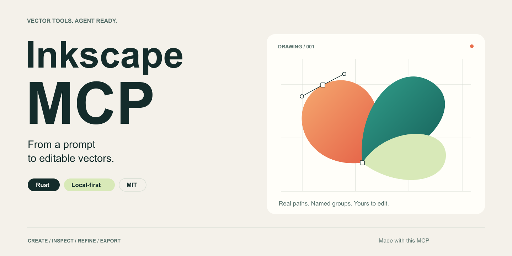
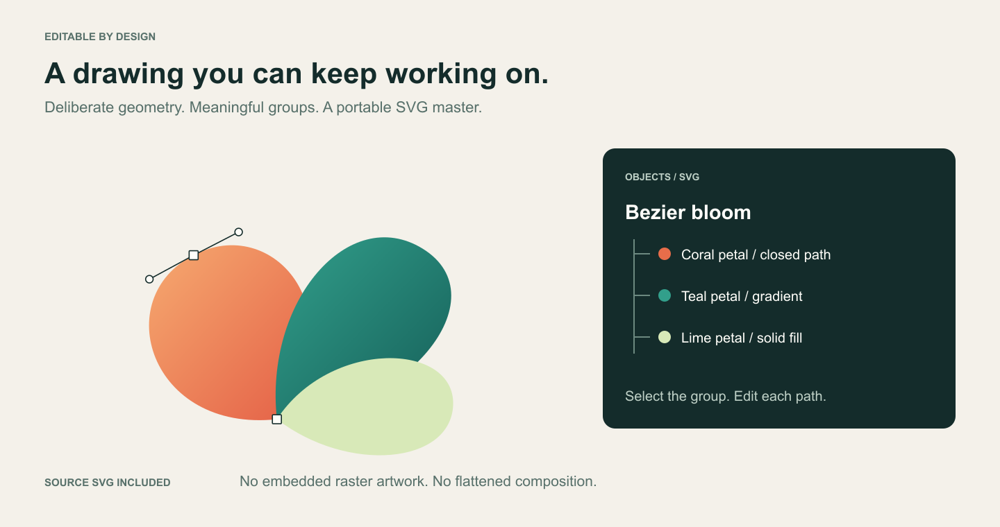
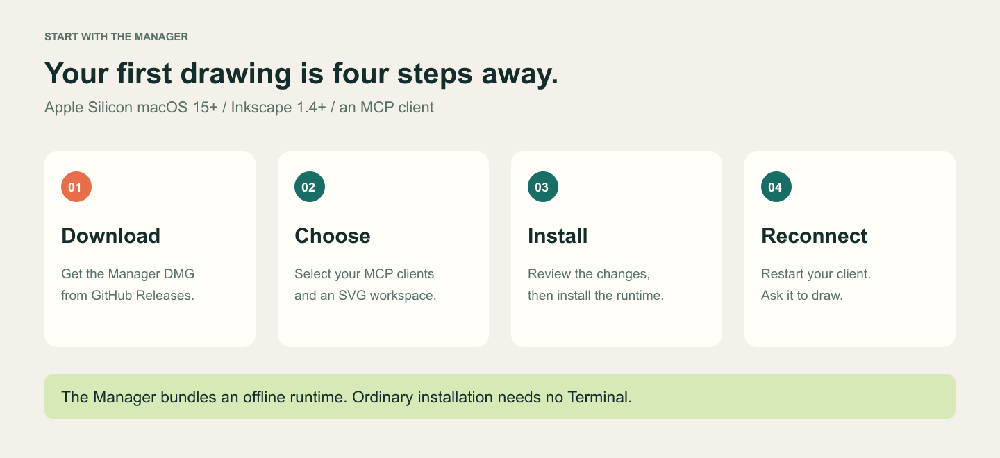
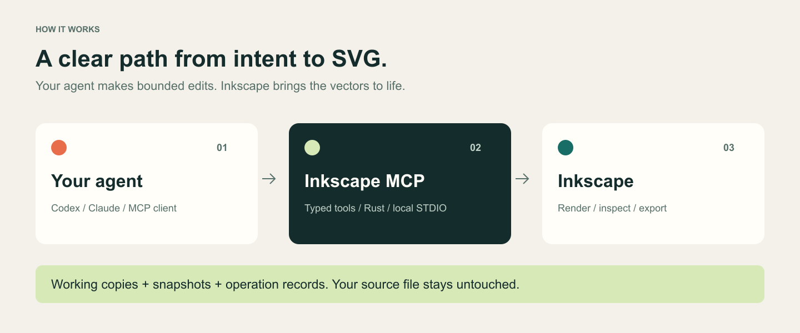

<p align="center">
  
</p>

<h1 align="center">Inkscape MCP</h1>

<p align="center">Give your AI agent a vector workspace.</p>

<p align="center">
  <a href="https://github.com/P1oN/inkscape-mcp-server/releases"></a>
  <a href="LICENSE"></a>
  <a href="rust/Cargo.toml"></a>
  <a href="https://m8ven.ai/mcp/p1on/inkscape-mcp-server?s=readme"></a>
</p>

<p align="center">
  <a href="https://github.com/P1oN/inkscape-mcp-server/releases">Download Manager</a> ·
  <a href="docs/agent-usage-guide.md">Agent guide</a> ·
  <a href="docs/README.md">Documentation</a> ·
  <a href="docs/AGENT_HANDOFF.md">Project status</a>
</p>

Create illustrations, diagrams and reusable SVG assets with Codex, Claude or another
MCP client. Inkscape MCP is a native Rust server that connects typed vector tools to
Inkscape's rendering engine. Draw, inspect, refine and export in one conversation.

**The artwork on this page was made through this MCP.** Editable SVG masters,
PNG exports and the [five-task sprint report](docs/history/reports/mcp-showcase-2026-11-15.md)
are included in the repository.

## What you can do

| Workflow | What you get |
| --- | --- |
| **Author vectors** | Shapes, Bezier paths, text, gradients and named groups you can keep editing. |
| **Inspect and refine** | Object discovery, focused previews, structural validation and vector-quality reports. |
| **Work reversibly** | Working copies, snapshots and operation records; genuine no-ops leave history alone. |
| **Export assets** | SVG masters, PNG previews and PDF output through Inkscape. |
| **Edit a live drawing** | Bounded operations on an explicitly selected drawing in a supported managed session. |



The sample bloom contains three closed paths, two gradients and separate control-handle
objects. Its [standalone SVG](docs/media/bezier-bloom.svg) can be opened and edited in
Inkscape. The [media guide](docs/media/README.md) lists all masters and exports.

## Start drawing



**Requirements:** Apple Silicon macOS 15+, Inkscape 1.4+ and an MCP client.

1. Open [GitHub Releases](https://github.com/P1oN/inkscape-mcp-server/releases) and download
   **Inkscape-MCP-Manager.dmg** from the current prerelease.
2. Open the Manager and choose your clients and an existing SVG workspace.
3. Review the installation and install the bundled runtime.
4. Restart or reconnect your MCP client, then ask it to draw.

The Manager includes an offline runtime. Ordinary installation needs no Terminal,
compiler or Python. Signed and notarized prereleases carry release-specific evidence;
see the [distribution contract](docs/install/macos-manager-distribution.md) and
[downloads and checksums](docs/install/github-builds.md).

Try this in your connected client:

> Create a small botanical illustration using three editable Bezier petals and a
> warm coral, teal and lime palette. Put the petals in one named group. Render it,
> inspect the result, then save a vector-only SVG and export a PNG in my workspace.

For configuration, supported clients and recovery, see
[installation](docs/install/install.md) and
[client management](docs/install/client-management.md).

## How it works



The everyday loop is **create or open → inspect → edit → render → refine → save/export**.
Edits land on a tracked working copy; saving is an explicit step. Workspace boundaries,
approval gates and snapshots are part of the workflow. See the
[agent guide](docs/agent-usage-guide.md) for the exact guarantees and limits.

Headless authoring does not need an open Inkscape window. Live editing uses a separately
managed, selected drawing; startup and reconnect never launch Inkscape. Native GUI
acceptance and working-copy rendering are tracked separately in the
[current status](docs/AGENT_HANDOFF.md).

## Set up from source

From a permanent checkout on a supported Mac with Inkscape installed:

```sh
./setup.sh --install-skill codex --connect-client codex
./run-mcp.sh --doctor
```

Use `claude` for both client options to connect Claude Code. Source setup requires
Apple Command Line Tools and builds the native runtime; see
[source prerequisites](docs/install/local-bootstrap.md). The optional
[agent skill](skills/inkscape-mcp/SKILL.md) teaches discovery, authoring, preview and export.

The Manager reviews runtime, instructions and Manager updates separately. Advanced
source upgrades, skill merging, rollback and removal are documented in
[independent updates](docs/install/independent-updates.md),
[Manager updates](docs/install/manager-self-update.md),
[skill installation](docs/install/agent-skill.md) and
[client management](docs/install/client-management.md).

## Develop and contribute

Start with [CONTRIBUTING.md](CONTRIBUTING.md). The project uses Rust regression tests,
real STDIO checks and scoped package/native acceptance. The retired Python implementation
remains available in Git history.

- [Architecture decisions](docs/adr/README.md) explain the typed, bounded tool design.
- [Tool manifest](llms.txt) and [full reference](llms-full.txt) describe the exposed surface;
  profiles and runtime gates can narrow discovery.
- [Active backlog](docs/RUST_NEXT_PLAN.md) records unfinished work.
- [Validation history](docs/history/README.md) keeps completed work and acceptance evidence.
- [Optional monitoring](docs/operations/sentry.md) describes opt-in Sentry configuration.

The project is **prerelease software**. Platform, clean-machine and native live acceptance
have explicit limits recorded in the handoff; a rendered example does not establish them.

## License

[MIT](LICENSE). Bundled dependency licenses and notices are recorded separately in the
[runtime documentation](runtime/README.md).
